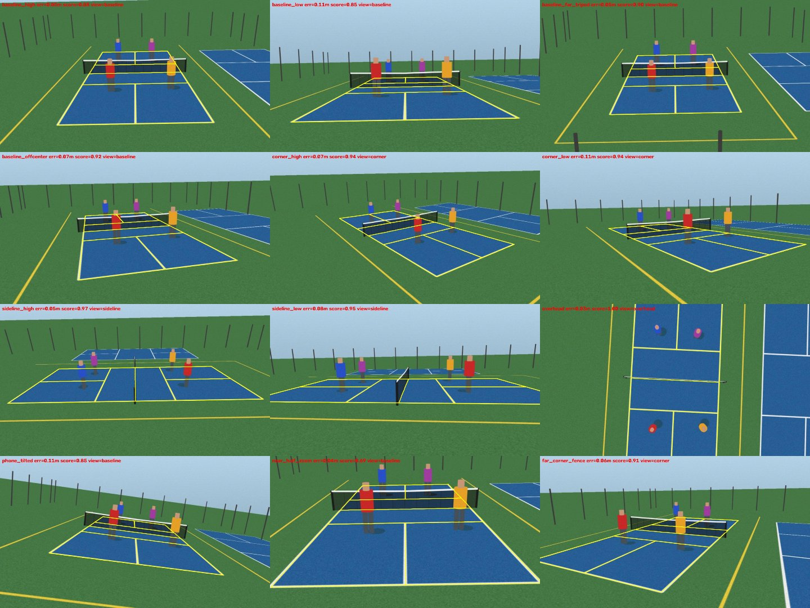

# Pickleball coach: angle-robust prototype

This prototype covers the first two stages of the [technical design](https://claude.ai/code/artifact/2aea91ea-6b8a-4047-ba5e-1941fc384f82). It finds the court and the camera in any match video, then tracks players in court meters. Everything after that (shots, decisions, coaching) can work in meters and does not need to know where the camera was.



## What it does

```
video ──► empty-court image (median of frames, or --empty-court photo)
      ──► court calibration: homography + camera position, height, focal length, view type
      ──► per frame: people ──► court position in meters ──► tracks (IDs, team side)
      ──► tracks.csv, metrics.json (distance, zones, kitchen-line time, partner spacing),
          calibration.jpg, overlay.mp4 (video + top-down minimap)
```

## Why it holds up when the camera angle changes

| Problem | What the prototype does instead of assuming a camera angle |
| --- | --- |
| Courts look different from each angle | Lines are grouped by the **vanishing point** they share, not by "horizontal or vertical". Every pairing of two court lines in one direction and two in the other is tried as a hypothesis |
| Wrong matches that look plausible, such as a neighbouring court, the net tape or two courts read as one | Each hypothesis has to fit a **real camera**: the court's two axes must come out perpendicular and equally scaled for some focal length. Stray painted lines inside the hypothesized court count against it, and so does a net that does not land on the court's midline |
| Tennis or other-sport lines on shared courts | Only near-white lines are kept. The test compares the change in color to the change in brightness, so it still works when a far line is only a pixel wide |
| Camera height and zoom are poorly determined from the court alone in baseline views | The **net tape** is a white line at a known height (34 to 36 in), so the focal length is the one that lands the predicted tape on it |
| "Bottom of the box = feet" fails for tilted, overhead and wide-angle shots | Players are located with a **ground-occupancy map**. For each 10 cm ground cell, it checks whether the image of a person-sized column standing there is covered by foreground. Each player found is erased before searching again, so players whose image blobs merge are separated |
| Far players' feet are hidden by the net | Hidden samples count as unknown, not empty, and the player is placed at the centre of the stretch the image allows |
| Speeds, gates and "team side" vary with the view | Tracking runs on the court plane in meters, using a Kalman filter and Hungarian assignment |
| Lines can't be found at all (night, worn paint) | Manual fallback: click 4 or more named court points (`--points`) |

## Results on synthetic footage (12 camera positions, random jitter)

The renderer (`pbcoach/synth.py`) adds a neighbouring court, yellow tennis lines, a fence, a translucent net, players, blur, noise and JPEG compression. The ground truth is exact.

**Court calibration**, 48 random views with players blocking lines (`python -m tests.eval_calibration --seeds 4 --players`):
- 45 of 48 views were within 15 cm mean ground error and 47 of 48 within 20 cm. The median error was 6.5 cm.
- The one failure was a zoomed shot showing only the near half of the court, which is genuinely ambiguous.
- Camera height was within 25 cm in every non-overhead view. A straight-down camera cannot measure its own height, but its ground positions are still accurate to 2 to 4 cm.

**Player positions**, 30-frame doubles rallies with the model-free occupancy detector (`python -m tests.eval_tracking`):

| View | Mean position error | Player-frames found within 50 cm |
| --- | --- | --- |
| sideline_high | 0.10 m | 100% |
| corner_high | 0.26 m | 84% |
| overhead | 0.18 m | 86% |
| baseline_far_tripod | 0.28 m | 83% |
| baseline_high | 0.25 m | 83% |
| sideline_low | 0.39 m | 80% |
| near_half_zoom | 0.25 m | 63% |
| baseline_offcenter | 0.26 m | 59% |
| far_corner_fence | 0.27 m | 58% |
| phone_tilted | 0.35 m | 56% |
| corner_low | 0.30 m | 50% |
| baseline_low | 0.52 m | 50% |

Low cameras (under about 2 m) lose the far players behind the net. That limit comes from geometry, not tuning: the image only says the player is somewhere along a line of sight. **Mount the camera at least 3 m high** if you can.

## Run it

The environment is managed with [uv](https://docs.astral.sh/uv/). `uv sync` creates `.venv` from `uv.lock`.

```bash
uv sync --extra yolo                                              # add the YOLO people detector (recommended for real footage)
uv run pbcoach match.mp4 --out runs/match1                        # YOLO people detector if installed
uv run pbcoach match.mp4 --out runs/match1 --detector foreground --empty-court empty.jpg
uv run pytest -q tests/test_core.py                               # 10 tests, about 30 s
uv run python -m tests.eval_calibration --seeds 4 --players       # angle-robustness benchmarks
uv run python -m tests.eval_tracking
```

Plain `uv sync` installs only the core dependencies (numpy, scipy, OpenCV) and pytest.

Manual calibration file for `--points`:

```json
{"keypoints": ["near_left", "near_right", "far_right", "far_left"],
 "image_points": [[212, 640], [1080, 655], [890, 300], [400, 296]]}
```

Keypoint names are listed in `pbcoach/court.py` (`KEYPOINTS`).

## Layout

| File | Role |
| --- | --- |
| `pbcoach/court.py` | Court model in meters, keypoints, zones |
| `pbcoach/lines.py` | Line-pixel mask (white only), line fitting, vanishing-point families |
| `pbcoach/calibrate.py` | Hypothesis search, scoring, refinement, net-tape focal length, manual fallback |
| `pbcoach/camera.py` | Camera pose from homography, camera-consistency test, view type |
| `pbcoach/players.py` | YOLO and occupancy detectors, angle-aware foot points, court-plane tracker |
| `pbcoach/metrics.py` | Distance, zone share, kitchen-line time, partner spacing |
| `pbcoach/pipeline.py` | Command-line entry point |
| `pbcoach/synth.py` | Synthetic multi-angle renderer used by the tests |

## Not yet validated

- **Real footage.** Every number above comes from synthetic renders. The YOLO path runs, but it has not been scored on real players. The next step is a few real clips from different angles, hand-labelled for player positions.
- **Lens distortion.** GoPro and phone ultra-wide lenses bend court lines. A distortion parameter is needed in the line fit.
- **Moving cameras.** The prototype assumes a fixed tripod. A handheld phone needs re-calibration per segment.
- **Ball tracking and shots.** These are stage 3 of the design and not started.
