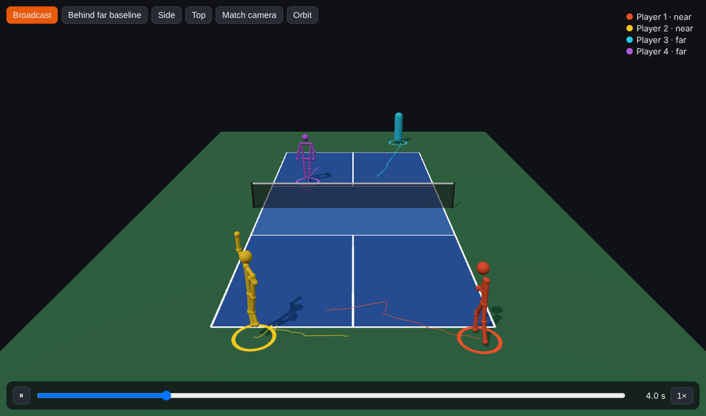
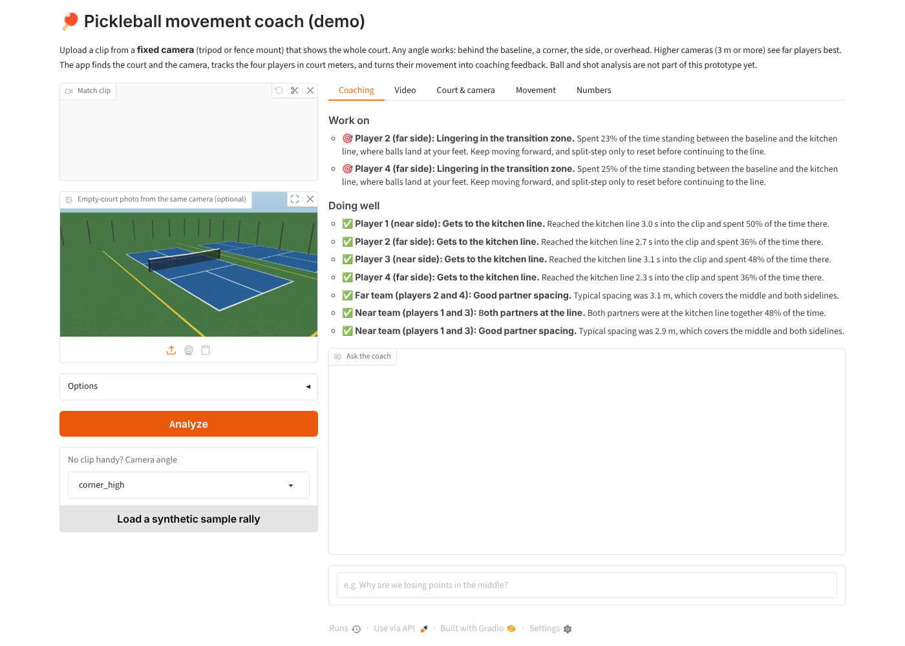
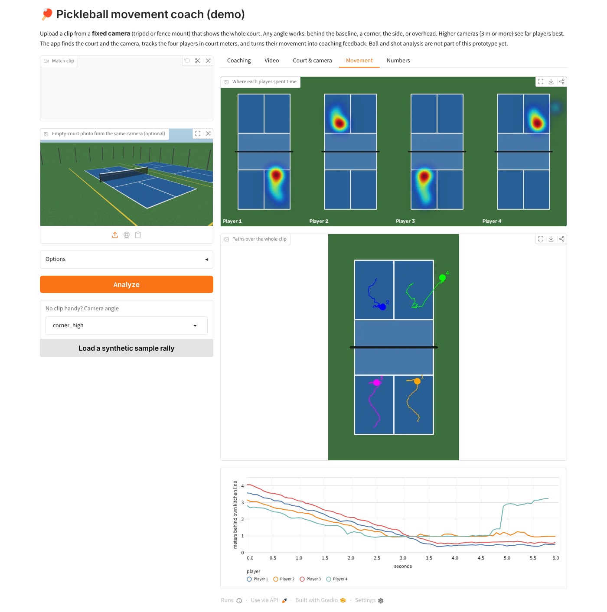

# Pickleball and tennis coach: angle-robust prototype

This prototype covers the first two stages of the [technical design](https://claude.ai/code/artifact/2aea91ea-6b8a-4047-ba5e-1941fc384f82). It finds the court and the camera in any match video, then tracks players in court meters. It works for pickleball and, with `--sport tennis`, for tennis singles and doubles (see [Tennis](#tennis)). Everything after that (shots, decisions, coaching) can work in meters and does not need to know where the camera was.


## What it does

```
video ──► empty-court image (median of frames, or --empty-court photo)
      ──► court calibration: homography + camera position, height, focal length, view type
      ──► per frame: people ──► court position in meters ──► tracks (IDs, team side)
      ──► tracks.csv, metrics.json (distance, zones, kitchen-line time, partner spacing),
          calibration.jpg, overlay.mp4 (video + top-down minimap)
```

## Why it holds up when the camera angle changes

| Problem | What the prototype does instead of assuming a camera angle |
| --- | --- |
| Courts look different from each angle | Lines are grouped by the **vanishing point** they share, not by "horizontal or vertical". Every pairing of two court lines in one direction and two in the other is tried as a hypothesis |
| Wrong matches that look plausible, such as a neighbouring court, the net tape or two courts read as one | Each hypothesis has to fit a **real camera**: the court's two axes must come out perpendicular and equally scaled for some focal length. Stray painted lines inside the hypothesized court count against it, and so does a net that does not land on the court's midline |
| Tennis or other-sport lines on shared courts | Only near-white lines are kept. The test compares the change in color to the change in brightness, so it still works when a far line is only a pixel wide |
| Camera height and zoom are poorly determined from the court alone in baseline views | The **net tape** is a white line at a known height (34 to 36 in), so the focal length is the one that lands the predicted tape on it |
| "Bottom of the box = feet" fails for tilted, overhead and wide-angle shots | Players are located with a **ground-occupancy map**. For each 10 cm ground cell, it checks whether the image of a person-sized column standing there is covered by foreground. Each player found is erased before searching again, so players whose image blobs merge are separated |
| Far players' feet are hidden by the net | Hidden samples count as unknown, not empty, and the player is placed at the centre of the stretch the image allows |
| Speeds, gates and "team side" vary with the view | Tracking runs on the court plane in meters, using a Kalman filter and Hungarian assignment |
| Lines can't be found at all (night, worn paint) | Manual fallback: click 4 or more named court points (`--points`) |

## Results on synthetic footage (12 camera positions, random jitter)

The renderer (`pbcoach/synth.py`) adds a neighbouring court, yellow tennis lines, a fence, a translucent net, players, blur, noise and JPEG compression. The ground truth is exact.

**Court calibration**, 48 random views with players blocking lines (`python -m tests.eval_calibration --seeds 4 --players`):
- 45 of 48 views were within 15 cm mean ground error and 47 of 48 within 20 cm. The median error was 6.5 cm.
- The one failure was a zoomed shot showing only the near half of the court, which is genuinely ambiguous.
- Camera height was within 25 cm in every non-overhead view. A straight-down camera cannot measure its own height, but its ground positions are still accurate to 2 to 4 cm.

**Player positions**, 45-frame doubles rallies with the model-free occupancy detector (`python -m tests.eval_tracking`):

| View | Mean position error | Player-frames found within 50 cm |
| --- | --- | --- |
| sideline_high | 0.12 m | 100% |
| sideline_low | 0.34 m | 97% |
| overhead | 0.20 m | 86% |
| baseline_high | 0.26 m | 83% |
| baseline_far_tripod | 0.32 m | 82% |
| corner_high | 0.23 m | 78% |
| near_half_zoom | 0.28 m | 63% |
| baseline_offcenter | 0.26 m | 58% |
| far_corner_fence | 0.31 m | 58% |
| baseline_low | 0.41 m | 56% |
| phone_tilted | 0.25 m | 50% |
| corner_low | 0.31 m | 43% |

Low cameras (under about 2 m) lose the far players behind the net. That limit comes from geometry, not tuning: the image only says the player is somewhere along a line of sight. **Mount the camera at least 3 m high** if you can.

## Tennis

`--sport tennis` (or the **Sport** picker in the demo) swaps in an ITF court: 23.77 x 10.97 m with singles sidelines, service lines 6.40 m from the net, the center service line and center marks, and a net 0.914 m high in the middle and 1.07 m at posts that stand 0.914 m outside the court. Everything sport-specific lives on one `Court` object in `pbcoach/court.py` (`PICKLEBALL`, `TENNIS`), and the calibration, tracker, maps, 3D replay and click-to-fix points all read it from the calibration. Pickleball remains the default.

What changes for tennis:
- **Singles by default** (`--players 2`), doubles with `--players 4`. The tracker keeps one identity per side in singles, so ball kids and line judges do not become players.
- **Run-off.** Tennis players spend much of a rally 1 to 4 m behind the baseline, so people are searched for up to 3.66 m beside and 6.4 m behind the court (the ITF minimum run-off) instead of 2 m.
- **Sub-pixel line fit.** Viewed from behind the baseline, a 24 m court's far end is a few pixels tall, and the coarse search left it up to 0.8 m short. A final least-squares fit of every line pixel to its court line fixes that; it is used for pickleball too and left its accuracy unchanged.
- **Colored lines on shared courts.** Pickleball lines are often painted inside tennis courts, and compressed video smears a thin colored line's color into its neighbours. The white-line filter now judges each pixel by the strongest color next to it, which halved how many yellow line pixels got through.
- **Far players.** A player on the far baseline can be 30 m from the camera, where one pixel along the line of sight spans most of a meter. Players found on the court plane are now slid along the line of sight onto the cells whose exact foot pixel is on them, which cut the far player's error from about 1.1 m to 0.25 m from a high corner.

**Coaching** (rules in `pbcoach/coach.py`, movement only, no ball or strokes):
- How far behind the baseline each player usually stands (flagged beyond 3 m).
- Time in no-man's land: between the baseline and the service line without moving forward.
- Net approaches, counted when a player gets within 1 m of the service line or closer for at least half a second.
- Singles: how fast a player gets back toward the middle after being pulled wide.
- Doubles: formation (both back, one up and one back, both up), partners on the same half in one-up-one-back, and the gap between partners when both are back.

With `ANTHROPIC_API_KEY` set, Claude gets a tennis coach's brief instead of the pickleball one.

**Results on synthetic tennis footage.** The renderer draws a tennis court with yellow pickleball lines inside it, a neighbouring court, fence, net, players, blur, noise and JPEG compression.

Court calibration, 24 random views with players (`python -m tests.eval_calibration --sport tennis --seeds 2 --players`): 18 of 24 within 15 cm mean ground error, median 10 cm. The misses are the cameras under 2 m (behind the baseline, at a corner, on the side), at 0.2 to 0.5 m: from that low, a 24 m court's far half is a thin sliver, and the yellow pickleball lines sit 0.3 m from the far service line.

Player positions, 45-frame rallies (`python -m tests.eval_tracking --sport tennis --players 2`, then `--players 4`):

| View | Singles: mean error | Singles: within 50 cm | Doubles: mean error | Doubles: within 50 cm |
| --- | --- | --- | --- | --- |
| broadcast_high (8 m behind the baseline) | 0.16 m | 100% | 0.16 m | 100% |
| overhead | 0.12 m | 100% | 0.14 m | 100% |
| sideline_high | 0.22 m | 100% | 0.18 m | 87% |
| corner_high | 0.32 m | 68% | 0.27 m | 84% |
| baseline_fence_high | 0.30 m | 70% | 0.28 m | 77% |
| phone_tilted | 0.46 m | 53% | 0.31 m | 48% |
| near_half_zoom (far half out of frame) | 0.41 m | 50% | 0.42 m | 53% |
| baseline_offcenter | 0.45 m | 50% | 0.46 m | 51% |
| baseline_low | 0.17 m | 50% | 0.34 m | 41% |
| far_corner_fence | 0.66 m | 40% | 0.58 m | 44% |
| corner_low | 0.39 m | 29% | 0.25 m | 51% |
| sideline_low | 0.73 m | 10% | 0.59 m | 34% |

Near players are found almost everywhere; the misses are mostly the far player 25 m or more away. For tennis, **put the camera high**: behind the baseline at 5 m or more (fence or stands), or high on the side. A camera at head height behind the baseline only places the far player to about a meter.

## Demo app

Upload a clip and see everything in the browser:
- **Replay:** an interactive 3D rebuild of the rally (posed players, ground rings, trails; orbit, camera presets, slow motion) next to the tracked video with pose skeletons and a top-down map.
- **Coaching:** findings plus an "ask the coach" chat.
- **Court & camera**, **Movement** (heatmaps, paths, distance behind the kitchen line) and **Numbers** (tables and downloads, including `replay.json`).

```bash
uv sync --extra demo --extra yolo     # yolo adds the people and pose models, needed for real footage
uv run pbcoach-demo                   # open http://localhost:7860 (add --share for a temporary public link)
```

No footage at hand? Pick a camera angle and click **Load a synthetic sample rally**.

If the detected court lines are off (very low cameras, unusual court colors), open **Fix the court**, pick a court point from the list and click where it is in the first frame. Four points that are not all on one line are enough, and points out of frame can be skipped.

Coaching feedback comes from rules over the tracks (`pbcoach/coach.py`). For pickleball: time to reach the kitchen line, standing in the transition zone, partners split up and back, and partner spacing. For tennis, see [Tennis](#tennis). With `ANTHROPIC_API_KEY` set, Claude also writes a short debrief and answers free-form questions. It sees only the computed numbers and findings, not the video. Set `PBCOACH_MODEL` to change the model.

The 3D view loads three.js from cdn.jsdelivr.net, so the browser needs internet access.





### How far players are tracked

From a camera at head height, one pixel on the far side of the court can span most of a meter, and the net hides feet. The tracker accounts for that:
- A second, zoomed YOLO pass over the far court finds small players; pose comes from each person's enlarged crop.
- Feet come from the ankles when visible; people cut off by the frame edge are placed from their head height instead.
- Each position carries its own uncertainty (meters per pixel at that spot), fused with the distance implied by the person's apparent height, so far players are smoothed hard and near players stay precise.
- Doubles has two players per side (singles one) and nobody crosses the net mid-rally: a side never holds more identities than that, and a lost player is re-acquired by shirt color instead of getting a new ID. Ball kids, line judges and the other court's players are ignored the same way.
- Paths are smoothed offline (running median, then Gaussian) before metrics and the replay.

Skeletons are steadied the same way (`pbcoach/pose.py`). The pose model looks at each frame on its own, so joints shake by a few pixels and a hidden limb comes back as a confident guess in the wrong place. Each player's joints are taken relative to their box, single-frame jumps are dropped, dropouts up to 0.4 s are bridged, and the rest is smoothed over time, more for small far players. On the PPA clip this cut frame-to-frame joint shake about 3x without lagging fast swings. Larger pose models were only about 15% steadier and 1.6 to 5x slower, so the small one stays the default (`--pose-model yolov8s-pose.pt` to change it).

## Run it

The environment is managed with [uv](https://docs.astral.sh/uv/). `uv sync` creates `.venv` from `uv.lock`.

```bash
uv sync --extra yolo                                              # add the YOLO people detector (recommended for real footage)
uv run pbcoach match.mp4 --out runs/match1                        # YOLO people detector if installed
uv run pbcoach match.mp4 --out runs/match1 --detector foreground --empty-court empty.jpg
uv run pbcoach tennis.mp4 --sport tennis --out runs/tennis1           # singles; add --players 4 for doubles
uv run pytest -q tests/test_core.py                               # 23 tests
uv run python -m tests.eval_calibration --seeds 4 --players       # angle-robustness benchmarks
uv run python -m tests.eval_tracking
uv run python -m tests.eval_calibration --sport tennis --seeds 2 --players
uv run python -m tests.eval_tracking --sport tennis --players 2  # or 4 for doubles
```

Plain `uv sync` installs only the core dependencies (numpy, scipy, OpenCV) and pytest.

Manual calibration file for `--points`:

```json
{"keypoints": ["near_left", "near_right", "far_right", "far_left"],
 "image_points": [[212, 640], [1080, 655], [890, 300], [400, 296]]}
```

Keypoint names are listed in `pbcoach/court.py` (`PICKLEBALL.keypoints`, `TENNIS.keypoints`).

## Layout

| File | Role |
| --- | --- |
| `pbcoach/court.py` | Pickleball and tennis court models in meters: lines, keypoints, net, run-off, zones |
| `pbcoach/lines.py` | Line-pixel mask (white only), line fitting, vanishing-point families |
| `pbcoach/calibrate.py` | Hypothesis search, scoring, refinement, net-tape focal length, manual fallback |
| `pbcoach/camera.py` | Camera pose from homography, camera-consistency test, view type |
| `pbcoach/players.py` | YOLO and occupancy detectors, angle-aware foot points, court-plane tracker |
| `pbcoach/metrics.py` | Distance, zone share, kitchen-line time or baseline depth, partner spacing, tennis doubles formation |
| `pbcoach/pipeline.py` | Command-line entry point |
| `pbcoach/coach.py` | Rule-based coaching findings for each sport, optional Claude debrief and Q&A |
| `pbcoach/report.py` | Heatmaps, paths and distance behind the kitchen line (or baseline) |
| `pbcoach/demo.py` | Gradio web demo (`pbcoach-demo`) |
| `pbcoach/pose.py` | Offline skeleton smoothing, outlier and dropout handling |
| `pbcoach/replay3d.py` | Self-contained three.js 3D replay page |
| `pbcoach/synth.py` | Synthetic multi-angle renderer used by the tests |

## Not yet validated

- **Real footage.** The numbers above come from synthetic renders. One real indoor clip (camera about 1.7 m high behind a corner, low resolution) now tracks all four players with steady identities, but far-side positions there are still only good to about a meter, and automatic court finding needed hand-placed points. Hand-labelled real clips from several angles are the next step.
- **Lens distortion.** GoPro and phone ultra-wide lenses bend court lines. A distortion parameter is needed in the line fit.
- **Moving cameras.** The prototype assumes a fixed camera. Broadcast clips with camera cuts are split at each cut and the longest shot is analyzed; a handheld or panning camera still needs re-calibration per segment.
- **3D poses** are a single-camera approximation: each 2D skeleton is stood upright in a plane facing the camera, so limbs pointing at the camera come out flattened.
- **Ball tracking and shots.** These are stage 3 of the design and not started, for either sport.
- **Real tennis footage.** Tennis has only been run on synthetic renders so far.
